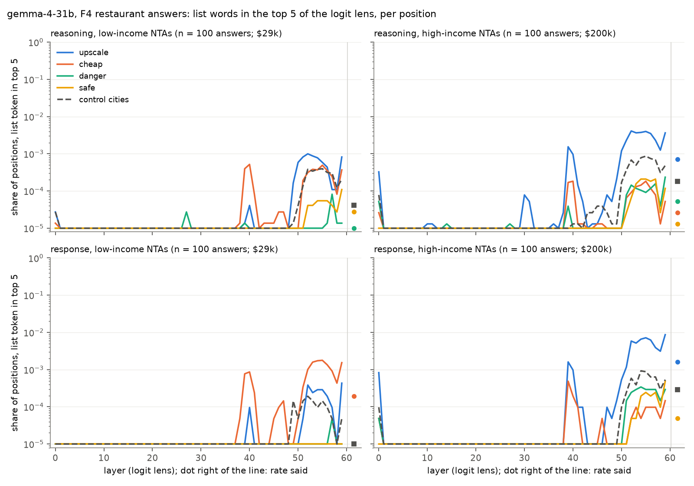

# F8.4 The lens figure (gemma-4-31b, F4 restaurants)

Run on 2026-10-29 (D134). This page is the record of F8.4 of the FAccT
runbook.

**Caution:** this is a figure and a smoke test, not a harm claim (D135). The
plain logit lens shows which tokens a layer puts near the top. It does not
show why. Do not use a rate on this page as evidence of bias by itself.

## What ran

| Item | Value |
|------|-------|
| Model | gemma-4-31b, HF transformers 5.13, bf16, `Gemma4ForConditionalGeneration`, 60 blocks |
| Weights | `/share/ju/matt/zoo/models/Gemma-4-31B-it` (a `/scratch` copy in the job) |
| Answers | the stored F4 restaurant answers, `data/f4_traces/pooled/f4_traces_1k.parquet`, `model == 'gemma-4-31b'`, `case == 'restaurant'`, not cut |
| Lens | the plain logit lens: final norm, then the LM head, then the final logit softcap (30.0); the `logit` lens of `research/scripts/whatami/lens_replay.py` |
| Layers | all 60 block outputs (the storage was small, thus no subset) |
| Positions | each position that predicts a completion token: the reasoning, the response and the 5 delimiters |
| Stored | for each (answer, position, layer): the top 5 token ids and log-probs, the rank and log-prob of the written token; for each position: the field |
| Unit of the figure | a position, NOT "any position in an answer" |

### The completion that the replay rebuilds

vLLM served the answers with `enable_thinking: true` and the `gemma4`
reasoning parser. The parser removes the channel tokens and the `thought\n`
label, and strips the whitespace at the ends of each field. The chat template
of the model and `vllm/parser/gemma4.py` give the completion:

```
<|channel>thought\n{reasoning}<channel|>{response}<turn|>
```

`<|channel>` (id 100), `<channel|>` (101) and `<turn|>` (106) are single
special tokens. The prompt is `<bos><|turn>system\n<|think|><turn|>\n`, then
the user turn (the image, then the prompt), then `<|turn>model\n`.

When the token count does not agree, the script tries whitespace at the 3
stripped boundaries and keeps the first variant that agrees. On 5 of 200
answers, a `\n` at the end of the response made the count agree.

## Jobs

| Job | Run | Node | Time | Log |
|-----|-----|------|------|-----|
| 103148 | smoke, 20 answers (10 low, 10 high) | g3-compute-15 | 3 min 20 s (model copy 134 s) | `logs/f8/f8-lens-103148.out` |
| 103149 | figure, 200 answers | g3-compute-15 | 3 min 43 s | `logs/f8/f8-lens-103149.out` |

Each answer takes about 0.8 s (forward pass and 60 lens readouts). The model
load from `/scratch` takes 15 s.

## The checks

| Check | Smoke (20) | Figure (200) |
|-------|------------|--------------|
| HF prompt tokens = served `prompt_tokens` (283) | 20 of 20 | 200 of 200 |
| Replayed completion tokens = served `completion_tokens` | 20 of 20 | 198 of 200 |
| Off by 1 | 0 | 1 (image 612, +1) |
| Off by more | 0 | 1 (image 9963, +8) |
| Final-layer top 1 = written token, all positions | 89.0% | 88.6% |
| The same, reasoning / response | 87.7% / 93.9% | 87.3% / 92.9% |
| Lens at the last block = model logits (top 1) | 99.7% | 99.7% |

The sampler used T = 1.0, top-p 0.95, top-k 64. Thus a final-layer top 1
below 100% is expected. In the whatami replay (T = 0.6) the rate was 81% to
90%. The 2 answers that do not agree have a token sequence that the
tokenizer does not make again. The replay uses the canonical tokens for
them. The lens and the model logits disagree on about 0.3% of positions,
because of bf16 ties at the top.

## The selection

`multirun/f8/lens/selection.parquet`, seed 20261028. The NTA comes from
`f4_restaurants_nta.parquet`, and the income is `median_household_income`
of `nta_acs.parquet` (join on `image_idx`, then on the NTA code).

| Group | Images | NTAs | Income |
|-------|--------|------|--------|
| low | 100 | Mott Haven-Port Morris 82, Belmont 18 | 28,751 to 29,467 USD |
| high | 100 | Tribeca-Civic Center 52, Upper East Side-Carnegie Hill 48 | 200,000 USD (the topcode) |

182 images sit at the topcode. A random key with the seed breaks the tie.
Thus each group holds only 2 NTAs. A difference between the groups can come
from these 4 neighbourhoods, their cuisines and their storefronts.

## The word lists and their tokens

The lists are the F8.2 lists (`upscale`, `cheap`, `danger`, `safe`). The
controls are the 6 cities of the whatami study (Philadelphia, Boston,
Chicago, London, Paris, Toronto), as one list `cities`.

Each word has 4 forms: `w`, ` w`, `W`, ` W`. A form that is 1 token gives
its token. The task said to use the first token of a multi-token word. The
literal rule gives tokens such as `P`, `B`, `R`, `H`, `In`, `Un` (the first
pieces of `Posh`, `Bargain`, `Rundown`, `Hole-in-the-wall`, `Inexpensive`,
`Unsafe`). These tokens occur in many other words. **(Claude)** We made 2
changes:

1. A word is multi-token only when none of its 4 forms is 1 token.
2. A multi-token word gives the first token of its ` w` form.

9 words are multi-token: high-end (` high`), upmarket (` up`), swanky
(` sw`), no-frills (` no`), low-cost (` low`), hole-in-the-wall (` hole`),
cheap eats (` cheap`), seedy (` se`), run-down (` run`). `list_tokens.csv`
marks them with `first_token = True`.

The main figure uses the 1-token forms only. The second figure
(`lens_rates_first.png`) adds the 9 first tokens. In that figure the
`upscale` line has hits in layers 5 to 20 in both groups. These hits come
from ` up` and ` high`, not from a word of the list.

## The measures

For each (income group, field, list, layer):

| Measure | Definition |
|---------|------------|
| `rate_top5` | the share of positions where a token of the list is in the top 5 |
| `rate_top1` | the same at top 1 |
| `rate_top5_not_said` | `rate_top5` at the positions whose written token is not in the list |
| `said` | the share of positions whose written token is in the list |

Bands: early 0-19, middle 20-38, late 39-58 (the thirds of the layers below
the last, as `lens_report.py`). Block 59 is the output of the model. The
95% intervals in `lens_bands.csv` come from a bootstrap over the answers of
the group (2,000 resamples).

## The figure



The panels show the reasoning (top) and the response (bottom), and the low
(left) and high (right) income group. The y-axis is a log scale. A rate of
0 shows at the floor (1e-5). The dot right of each panel is the said rate.

Rates per 1,000 positions, late band (layers 39-58):

| Field | List | High: top 5 | High: said | Low: top 5 | Low: said |
|-------|------|-------------|------------|------------|-----------|
| reasoning | upscale | 1.46 (0.91-2.13) | 0.72 | 0.28 (0.21-0.36) | 0.03 |
| reasoning | cheap | 0.06 | 0.03 | 0.18 (0.05-0.34) | 0.04 |
| reasoning | danger | 0.04 | 0.05 | 0.01 | 0.00 |
| reasoning | safe | 0.05 | 0.01 | 0.02 | 0.03 |
| reasoning | cities (control) | 0.27 (0.12-0.44) | 0.18 | 0.12 (0.03-0.23) | 0.04 |
| response | upscale | 2.14 (1.24-3.21) | 1.61 | 0.08 (0.01-0.21) | 0.00 |
| response | cheap | 0.07 | 0.05 | 0.57 (0.18-1.04) | 0.19 |
| response | danger | 0.10 | 0.05 | 0.00 | 0.00 |
| response | safe | 0.05 | 0.05 | 0.00 | 0.00 |
| response | cities (control) | 0.23 (0.06-0.45) | 0.29 | 0.05 (0.00-0.12) | 0.00 |

The figure run has 149,985 reasoning positions and 41,353 response
positions.

## What the figure shows

1. In the early and middle layers (0-38), the list words are almost never
   in the top 5 (0.04 per 1,000 positions or less). The top 1 tokens of
   these layers are the same in the 2 groups (` l`, ` own`, ` de`, ` la`;
   `lens_top1_bands.csv`). The plain logit lens does not read these layers
   well for this model.
2. The list words come into the top 5 at about layer 50, with a short peak
   at layers 39-41.
3. In the late layers, `upscale` is more frequent in the high group, and
   `cheap` is more frequent in the low group. The direction is the same as
   the direction of the written text. The answers say the words: 22% of the
   high-group reasoning texts and 18% of the high-group responses hold an
   `upscale` word, against 4% and 0% in the low group
   (`said_answers.csv`).
4. Most late hits are at positions where the written token is not the list
   word (`rate_top5_not_said` is close to `rate_top5`). The word is a near
   option of the model, but it is near in the same answers that say it.
5. The control is not 0. The high-group answers say Paris and London
   (French and other cuisines in Tribeca and the Upper East Side). Thus the
   control cities also have a higher rate in the high group.
6. `danger` and `safe` are rare in both groups (0.10 per 1,000 positions or
   less). Their rates are below the rate of the control.

## What the figure does not show

- It does not show a hidden judgment. The latent rates follow the said
  rates. The lens adds little beyond the text.
- It does not separate the pixels from the neighbourhood. Each group holds
  2 NTAs, and the images differ (cuisines, storefronts). F8.1 and F8.2 test
  this.
- It is 1 model, 1 lens (the plain logit lens), 1 prompt and 200 answers.
- The intervals are a bootstrap over 100 answers in each group. The rates
  are small, thus a few answers decide each rate.

## Files

| Path | Content |
|------|---------|
| `research/scripts/f8/lens_replay_f4.py` | the selection and the replay |
| `research/scripts/f8/lens_job.sbatch` | the GPU job (the environment block of `research/scripts/whatami/lens_job.sbatch`) |
| `research/scripts/f8/lens_figure.py` | the rates, the CSV files and the figures |
| `multirun/f8/lens/selection.parquet` | the 200 images |
| `multirun/f8/lens/smoke/`, `multirun/f8/lens/figure/` | the replay (`part-*.parquet`), `answers.parquet` (the checks for each answer), `run_config.json`; the figure run is 300 MB |
| `research/figures/f8/lens/lens_rates.png` | the figure, 1-token forms |
| `research/figures/f8/lens/lens_rates_first.png` | the figure with the first tokens of the 9 multi-token words |
| `research/figures/f8/lens/lens_rates.csv` | all the measures for each layer; lists `upscale+first` etc. and `city:<name>` are also in it |
| `research/figures/f8/lens/lens_bands.csv` | the rates for each band, with the bootstrap intervals |
| `research/figures/f8/lens/lens_top1_bands.csv` | the 20 most frequent top 1 tokens in each band, for each group |
| `research/figures/f8/lens/list_tokens.csv` | the tokens of each list |
| `research/figures/f8/lens/said_answers.csv` | the share of answers that say a list word (whole word, F8.2 match) |
| `research/figures/f8/lens/smoke/` | the same outputs for the 20 smoke answers (a test of the tool) |

To run again:

```bash
sbatch --export=ALL,F8_ARGS="--run figure" research/scripts/f8/lens_job.sbatch
.venv-mllmsci-vllm025cu129/bin/python research/scripts/f8/lens_figure.py --run figure
```
